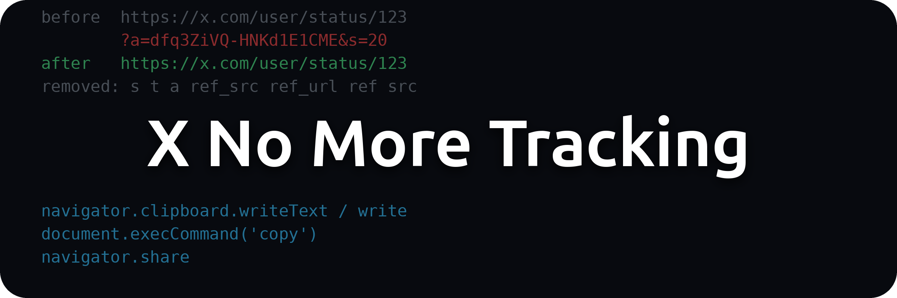

<div align="center">

<p align="center">
  
</p>

<p align="center"><a href="README.md">English</a> | <b>日本語</b></p>

<h1 align="center">X No More Tracking</h1>

<h3 align="center">X のリンクコピーから追跡パラメータを消す。</h3>

<p align="center">X（旧Twitter）の共有メニューで「リンクをコピー」を押したときに、URL へ付く追跡パラメータ（<code>?s=20</code> や <code>&amp;a=...</code> など）を取り除く Chrome / Edge 拡張機能です。</p>

<p align="center">
  <a href="LICENSE"></a>
  <a href="https://github.com/Lapius7/x-nomoretracking/stargazers"></a>
  <a href="https://github.com/Lapius7/x-nomoretracking/commits/main"></a>
</p>

<p align="center">
  <a href="#クイックスタート">クイックスタート</a> ·
  <a href="#取り除くパラメータ">取り除くパラメータ</a> ·
  <a href="#仕組み">仕組み</a>
</p>

</div>

## 概要

```
変更前  https://x.com/user/status/123?a=dfq3ZiVQ-HNKd1E1CME&s=20
変更後  https://x.com/user/status/123
```

- 権限の要求も、外部への通信もありません。
- 動くのは x.com / twitter.com のページ内だけです。アドレスバーの URL やページ遷移には触れません。

## クイックスタート

Chrome Web Store には公開していないので、ソースから読み込みます。

1. このリポジトリをダウンロードします（`git clone https://github.com/Lapius7/x-nomoretracking.git` か、ZIP を展開）。
2. `chrome://extensions`（Edge は `edge://extensions`）を開き、右上の「デベロッパー モード」をオンにします。
3. 「パッケージ化されていない拡張機能を読み込む」を押し、ダウンロードしたフォルダを選びます。
4. 開いている x.com のタブを再読み込みします。

更新するときは、リポジトリを取得し直し、拡張機能のページで更新ボタンを押してタブを再読み込みします。

## 取り除くパラメータ

`s` `t` `a` `ref_src` `ref_url` `ref` `src`

x.com / twitter.com / mobile.twitter.com の URL についているものだけが対象です。`?q=...` のような検索条件など、上の一覧にないパラメータは残ります。対象は `content.js` の `TRACKING` で変えられます。

## 仕組み

`content.js` を x.com のページ本体の JavaScript 環境（`world: "MAIN"`）で、ページの読み込み前に実行します。X の共有メニューがクリップボードへ書き込む経路をすべてフックし、書き込む直前に URL から上のパラメータを消します。

- `navigator.clipboard.writeText` / `navigator.clipboard.write`
- `document.execCommand('copy')`（隠し入力欄を選択してコピーする方式。`copy` イベントで中身を差し替える）
- `navigator.share`

> [!NOTE]
> X のコピーの方式が変わって効かなくなったときは、`content.js` に経路を足します。今回の README 作り直しでは、現在の X の画面での動作を再確認していません。

## ライセンス

[MIT](LICENSE)
