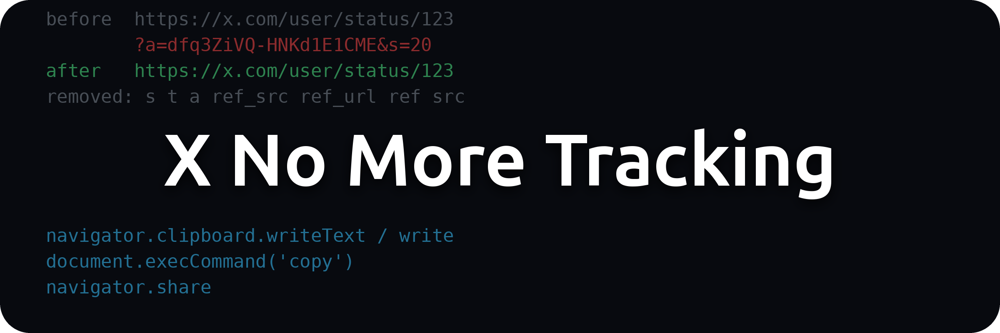

<div align="center">

<p align="center">
  
</p>

<p align="center"><b>English</b> | <a href="README.ja.md">日本語</a></p>

<h1 align="center">X No More Tracking</h1>

<h3 align="center">Copy X links without the tracking parameters.</h3>

<p align="center">A Chrome / Edge extension that removes tracking parameters such as <code>?s=20</code> and <code>&amp;a=...</code> from the URL when you press "Copy link" in the X (formerly Twitter) share menu.</p>

<p align="center">
  <a href="LICENSE"></a>
  <a href="https://github.com/Lapius7/x-nomoretracking/stargazers"></a>
  <a href="https://github.com/Lapius7/x-nomoretracking/commits/main"></a>
</p>

<p align="center">
  <a href="#quick-start">Quick start</a> ·
  <a href="#removed-parameters">Removed parameters</a> ·
  <a href="#how-it-works">How it works</a>
</p>

</div>

## Overview

```
Before  https://x.com/user/status/123?a=dfq3ZiVQ-HNKd1E1CME&s=20
After   https://x.com/user/status/123
```

- Requests no permissions and makes no network requests.
- Runs only on x.com and twitter.com pages. It does not touch the URL in the address bar or page navigation.

## Quick start

The extension is not published on the Chrome Web Store, so load it from source.

1. Download this repository (`git clone https://github.com/Lapius7/x-nomoretracking.git`, or extract the ZIP).
2. Open `chrome://extensions` (`edge://extensions` in Edge) and turn on "Developer mode" in the top right.
3. Click "Load unpacked" and select the downloaded folder.
4. Reload any open x.com tabs.

To update, fetch the repository again, press the refresh button on the extensions page, and reload the tabs.

## Removed parameters

`s` `t` `a` `ref_src` `ref_url` `ref` `src`

Only these parameters on x.com, twitter.com and mobile.twitter.com URLs are removed. Parameters not in this list, such as the search query in `?q=...`, are kept. You can change the list in `TRACKING` in `content.js`.

## How it works

`content.js` runs in the page's own JavaScript environment (`world: "MAIN"`) before the page loads. It hooks every route through which X's share menu writes to the clipboard and strips the parameters above from the URL just before it is written.

- `navigator.clipboard.writeText` / `navigator.clipboard.write`
- `document.execCommand('copy')` (the method that selects a hidden input and copies it; the `copy` event swaps the content)
- `navigator.share`

> [!NOTE]
> If X changes how it copies and the extension stops working, add the new route to `content.js`. This README does not claim the extension works with the current X web app; the author has not re-tested it for this rewrite.

## License

[MIT](LICENSE)
